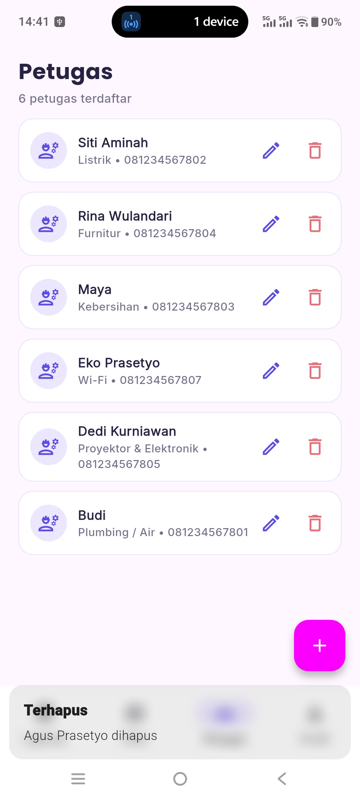
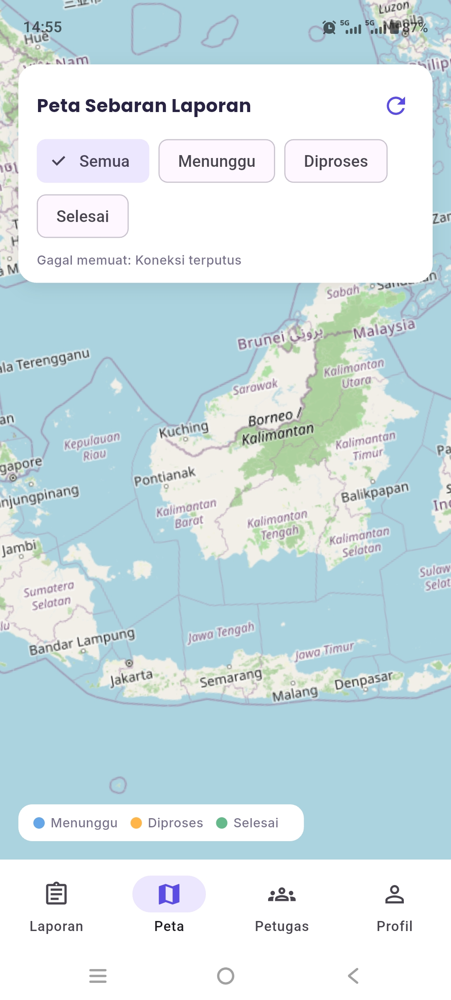
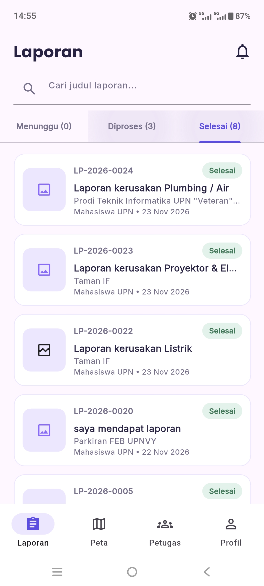

# Pembagian Tugas
1. Grandis: Bagian admin (LBS, CRUD), notif dan set up supabass.
2. Tsakif: Bagian user (CRUD, LBS, notif, dan models) dan Hive.

# CHALLENGE 
## Ubah warna button jadi pink dan snackbar jadi di bawah: 

## Implementasi Hive

# flutter_application_1

A new Flutter project.

## Getting Started

This project is a starting point for a Flutter application.

A few resources to get you started if this is your first Flutter project:

- [Learn Flutter](https://docs.flutter.dev/get-started/learn-flutter)
- [Write your first Flutter app](https://docs.flutter.dev/get-started/codelab)
- [Flutter learning resources](https://docs.flutter.dev/reference/learning-resources)

For help getting started with Flutter development, view the
[online documentation](https://docs.flutter.dev/), which offers tutorials,
samples, guidance on mobile development, and a full API reference.
